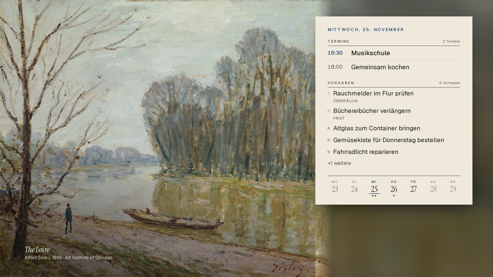
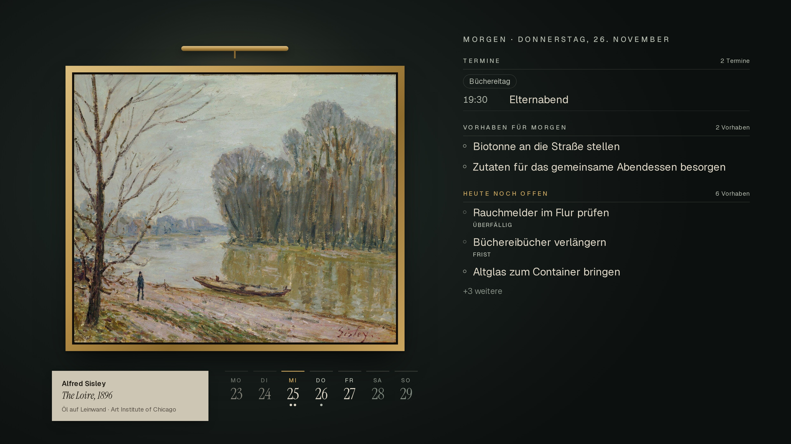

# Household Frame Dashboard

A read-only German household display for Samsung The Frame: public-domain
artwork, Machbar commitments and Home Assistant appointments. A genuine fork of
[joseamijares/frame-dashboard](https://github.com/joseamijares/frame-dashboard),
retaining its museum placard, evening gallery, artwork rotation and thin Tizen
shell. No task editor, Redis, Vercel, Google credentials or ICS feeds.





The images use synthetic household data and are 3840 x 2160 JPEGs. Artwork
sources are not necessarily native 4K. Remote: left/right browse the week;
OK returns to today; Back exits the Tizen shell.

**Integration status:** the dashboard and fixture-backed adapters are
implemented. Direct MCP supports **today's commitments and deadline attention
only**, using a dedicated Household agent token. It omits future task views,
revisit-only attention and completion recap; calendars retain their full range.
The full-range REST adapter still requires the separate
[read-only integration proposal, Machbar #383](https://github.com/temporaer/machbar/issues/383).
PocketID is optional. Signing and physical TV behavior still require operator
configuration/acceptance; the hosted shell has not been verified on hardware.

## Run locally with Conda

```sh
conda env create -f environment.yml
conda activate frame-dashboard
export LD_LIBRARY_PATH="$CONDA_PREFIX/lib${LD_LIBRARY_PATH:+:$LD_LIBRARY_PATH}"
npm ci
python -m playwright install chromium
cp .env.example .env.local
cp config.example.json config.json
# In .env.local, set DASHBOARD_CONFIG=config.json.
npm start
```

Open `http://127.0.0.1:4321`. The example deliberately enables isolated demo
mode: no source requests, TV connections or household credentials. The Node
backend alone needs Node 24 and `npm ci`; Python/Chromium are optional.
Nothing is installed system-wide by these commands.

```sh
npm run cli -- fetch
npm run cli -- projection
npm run worker -- render --at 2026-11-25T10:00:00Z --output artifacts/day.jpg
npm run worker -- render --at 2026-11-25T19:00:00Z --output artifacts/evening.jpg
npm run worker -- render --at 2026-11-25T10:00:00Z --variant quiet --output artifacts/quiet.jpg
```

`npm start`, `cli`, `worker` and `tizen:build` load the ignored `.env.local`
without shell-sourcing it. Exported variables take precedence. The native worker
wrapper defaults to the loopback backend and `data/art-worker`; direct
`python -m frame_worker` instead expects environment variables and defaults
suited to Compose.

## Connect household services

Set `DEMO_MODE=false` only after providing:

| Settings | Purpose |
| --- | --- |
| `MACHBAR_MCP_ENDPOINT`, `MACHBAR_TOKEN` | Full trusted HTTPS MCP endpoint and dedicated Household agent token; current-day tasks only |
| `MACHBAR_URL`, `MACHBAR_TRANSPORT` | Alternative base URL with `mcp`, or `rest` (default without MCP endpoint) for the proposed full-range API; see [integration](docs/machbar-integration.md) |
| `HA_URL`, `HA_TOKEN`, `HA_CALENDAR_ENTITIES` | Calendar range API; comma-separated entity IDs |
| `AUTH_MODE` | Set `token` for browser/TV display-token access without PocketID; `oidc` enables browser login (compatibility default) |
| `PUBLIC_URL` | Optional in token mode; required trusted HTTPS origin for OIDC or brightness telemetry |
| `OIDC_ISSUER`, `OIDC_CLIENT_ID`, `OIDC_CLIENT_SECRET`, `OIDC_ALLOWED_SUBJECTS` | Only for `AUTH_MODE=oidc`: separate PocketID client and exact authorized subject IDs |
| `DISPLAY_TOKEN`, `WORKER_TOKEN`, `ADMIN_TOKEN` | Three distinct random secrets of at least 32 characters each; generate each with `openssl rand -hex 32` |

Discover entities with `npm run cli -- calendars`; only `HA_URL` and `HA_TOKEN`
are needed for discovery. Do not commit the resulting identifiers or output.
With `AUTH_MODE=token`, open `/display#token=DISPLAY_TOKEN` in the browser or TV.
The revocable display token permits reading only; admin and worker tokens remain
separate. Provision that private URL, never publish it. No PocketID or app-side
certificate is needed. HTTP exposes tokens/data in transit: keep it on loopback
or an explicitly trusted private network; use HTTPS/VPN on untrusted networks.
If opting into OIDC, register `PUBLIC_URL/api/auth/callback` and authorize the
household identities. The backend still speaks HTTP behind the trusted proxy.

Configuration fails closed. Production source failures retain last-good data
with independent warnings; they never enable demo data. Only household
commitments/deadlines are displayed, not available backlog or private/work data.
Evening presentation does not reschedule anything. Five tasks, no invented
focus, no completion recap and no revisit-only attention are the defaults.
English artwork facts are omitted in the German display; original artwork
titles, provenance and licenses remain intact.

See [operations](docs/operations.md) for deployment, authentication, diagnostics,
backups and rollback; [Tizen](docs/tizen.md) for packaging/install; and
[native Art Mode](docs/art-mode.md) for safe optional rendering/TV setup.
The [architecture](docs/architecture.md) records upstream audits and differences.

An optional [brightness observer](docs/brightness.md), disabled by default,
reports lux-based candidates and foreground/HA blocking reasons. It has **no
TV-setting write path**; installing or enabling live control is not included.

## Optional container deployment

Docker is not needed for local development. For an existing Docker VM:

```sh
cp .env.example .env
cp config.example.json config.json
# Configure sources and distinct tokens; AUTH_MODE=token needs no PocketID.
# Configure trusted networking before disabling demo mode.
npm ci
npm run deploy
# Only after native Art Mode acceptance and ART_MODE_ENABLED=true:
docker compose --profile art up -d --build
```

The deployment helper runs on the Docker host with Node 24, supporting Compose
v2 or `docker-compose` v1. After each successful core build/start and authenticated
source-readiness check, it removes this deployment's superseded images, keeping
only the running image. Other deployments, images referenced by containers,
volumes and shared build caches are never pruned. Failed deployments preserve
old images; there is no retained rollback image after a successful deployment.

The Node image is non-root and has no Python/Chromium. Only the optional `art`
profile has the browser and TV library. Host publication defaults to loopback;
place a trusted reverse proxy there or explicitly bind an appropriate local
interface. Do not publish the unencrypted backend publicly.

## Validation and licensing

```sh
npm test
PYTHONPATH=worker python -m pytest -q worker/tests
python scripts/screenshots.py
```

CI uses fixtures and mocked services, plus container startup/restart and
containerized rendering. No production secrets, signing material or TV needed.

Code retains the upstream [MIT license](LICENSE); bundled fonts retain their
OFL notices and artwork metadata/credits remain with the assets. Wikipedia facts
retain source URLs and applicable CC BY-SA attribution. Ancillary Mac, Android
and launcher projects are retained as upstream code, not supported task-writing
clients of this read-only fork; their licenses/notices remain unchanged.
